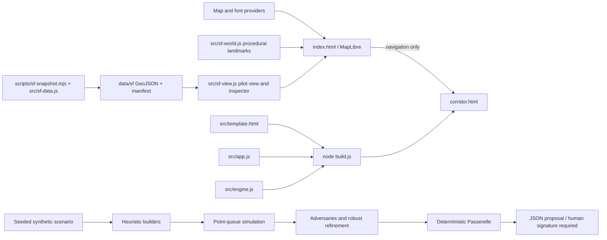

# Existing architecture

Current state: Phase 2B (San Francisco world foundation) complete — see `PHASE_2B_REPORT.md`.

CORE is a static two-page application with committed public-data snapshots. There is no backend, database, account system, worker pool, LLM service, telemetry pipeline, or infrastructure actuator.

## Globe

`index.html` embeds styling and application JavaScript. MapLibre GL JS 5.7.3 comes from unpkg (pinned; 5.6.0 crashed on terrain/navigation, see D010). It reads OpenFreeMap vector tiles/glyphs, optional AWS-hosted Terrarium elevation. Esri and Nominatim requests are disabled; search resolves pilot cities and coordinates locally. Extrusion heights use `render_height` with an 8 m fallback. The SoMa marker links to the separate synthetic corridor; it does not feed geometry into the simulator.

## San Francisco world (Phase 2B)

`src/sf-world.js` (UMD, Node-testable) generates procedural landmark geometry as GeoJSON for MapLibre fill-extrusions: the Golden Gate Bridge from published dimensions on OSM tower positions, and Salesforce/Transamerica silhouettes on OSM footprints. It also defines the SF navigation targets and the runtime replacement zones that hide overlapping OSM building parts. `src/sf-view.js` (browser) lazily adds landmarks near SF (zoom ≥ 9.5), loads `data/sf` snapshots (zoom ≥ 11 or pilot open), verifies each file's SHA-256 against `manifest.json` with Web Crypto, renders the pilot layers, filters, and the record inspector. It offsets bridge parts by terrain when 3D relief is on. No new runtime dependency: three.js was not needed.

`scripts/sf-snapshot.mjs` (Node built-ins) fetches DataSF SoQL queries, normalizes rows through `src/sf-data.js` (PII removal, organisation-only permit holders, no invented geometry, CNN normalization, corridor selection by CNN topology) and writes GeoJSON plus a manifest with URLs, timestamps and checksums. Raw responses are hashed, not stored. `test/sf.test.js` checks parsing, PII absence, manifest checksums/counts, corridor membership, landmark positions and replacement zones.

## Corridor and engine

`build.js` replaces two placeholders in the template with engine and UI source, producing a committed standalone HTML file for static hosting. `src/app.js` uses a hand-written 3D projection onto Canvas 2D; corridor buildings and globe outlines are illustrative. The live traffic display uses the same `Sim` class as plan evaluation.

`src/engine.js` exports CommonJS in Node and `globalThis.CORE` in browsers. Five intersections at 0/180/360/560/740 m use fixed speeds, FIFO point queues and seeded Poisson arrivals. A run simulates 1,800 seconds of demand plus 900 seconds of draining. There are no turns, physical spillback, observed pedestrian movements or calibration. `vehicles`/`servedN` count approach service events, not unique corridor travelers.

The UI runs `searchPlans` with 1,500 candidates, then `robustRefine` with 15 initial candidates and 240 mutations across six stress cases (1,530 evaluations). The displayed 3,030 count excludes additional reference evaluations. Agents are seeded heuristics: green waves, random exploration, mutation and worst-case ranking. They run on the browser main thread, yielding between chunks; no persistent or distributed agent orchestration exists.

## Permit boundary

`issuePermit` operates on internal stress summaries: any tested ratio above 1 suspends; otherwise nominal gain below 5% blocks; otherwise the state is ready for signature. Scenario toggles recompute stress tests and the permit synchronously. Outcomes are relative only to the assumed baseline.

The JSON includes the plan, reasons, comparisons, synthetic-data assumptions, validity text, reversibility text and a mandatory human-signature statement. It does not authenticate users, record signatures, enforce expiration, monitor real evidence or transmit commands. Phase 1 snapshots and validates the complete six-case evidence contract (model/twist dependencies, ordered case IDs, finite bounded metrics, consistent ratios/summaries and feasible plans). Invalid evidence returns a blocked envelope without a plan or gains. The gateway then re-runs the deterministic stress test for the submitted plan and dependencies and requires every reported delay to match, so evidence for a different plan or fabricated-but-consistent numbers are blocked (D012). This binds evidence to the engine; it is not authentication of users, data sources or signatures. This is a demonstration rule boundary, not a production authorization boundary.

## Verification

`node build.js` assembles; `node --test test/*.test.js` checks assembly, parsing, reproducibility, bounded orchestration and permit states. Browser checks use a local HTTP server. No runtime dependencies were added in Phase 0. Phase 1 explicitly authorized correctness hardening. Equations and valid decision thresholds were preserved; input guards, scenario isolation, bounded execution and cancellation were added. UI clears stale proposals on failure/cancel, throttles DOM updates and uses capped elapsed-time stepping. Phase 1 and Phase 2B closing browser audits are summarized in their reports; `scripts/browser-audit.mjs` now includes 18 San Francisco checks.
