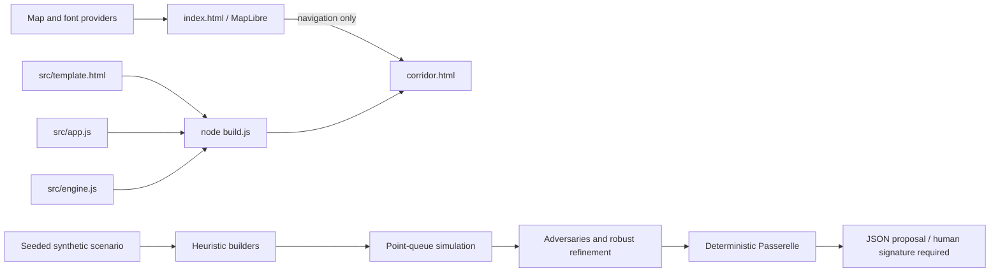

# Existing architecture

CORE is a static two-page application. There is no backend, database, account system, worker pool, LLM service, telemetry pipeline, or infrastructure actuator.

## Globe

`index.html` embeds styling and application JavaScript. MapLibre GL JS 5.6.0 comes from unpkg. It reads OpenFreeMap vector tiles/glyphs, optionally Esri raster imagery and AWS-hosted Terrarium elevation, and submits user searches to Nominatim. Extrusion heights use `render_height` with an 8 m fallback. The SoMa marker links to the separate synthetic corridor; it does not feed geometry into the simulator.

## Corridor and engine

`build.js` replaces two placeholders in the template with engine and UI source, producing a committed standalone HTML file for static hosting. `src/app.js` uses a hand-written 3D projection onto Canvas 2D; corridor buildings and globe outlines are illustrative. The live traffic display uses the same `Sim` class as plan evaluation.

`src/engine.js` exports CommonJS in Node and `globalThis.CORE` in browsers. Five intersections at 0/180/360/560/740 m use fixed speeds, FIFO point queues and seeded Poisson arrivals. A run simulates 1,800 seconds of demand plus 900 seconds of draining. There are no turns, physical spillback, observed pedestrian movements or calibration. `vehicles`/`servedN` count approach service events, not unique corridor travelers.

The UI runs `searchPlans` with 1,500 candidates, then `robustRefine` with 15 initial candidates and 240 mutations across six stress cases (1,530 evaluations). The displayed 3,030 count excludes additional reference evaluations. Agents are seeded heuristics: green waves, random exploration, mutation and worst-case ranking. They run on the browser main thread, yielding between chunks; no persistent or distributed agent orchestration exists.

## Permit boundary

`issuePermit` operates on internal stress summaries: any tested ratio above 1 suspends; otherwise nominal gain below 5% blocks; otherwise the state is ready for signature. Scenario toggles recompute stress tests and the permit synchronously. Outcomes are relative only to the assumed baseline.

The JSON includes the plan, reasons, comparisons, synthetic-data assumptions, validity text, reversibility text and a mandatory human-signature statement. It does not authenticate users, record signatures, enforce expiration, monitor real evidence or transmit commands. Input summaries are trusted; malformed evidence is not validated. This is a demonstration rule boundary, not a production authorization boundary.

## Verification

`node build.js` assembles; `node --test test/*.test.js` checks assembly, parsing, reproducibility, bounded orchestration and permit states. Browser checks use a local HTTP server. No runtime dependencies were added in Phase 0. Retain the deterministic engine until a separate scoped change explicitly authorizes modifications.
