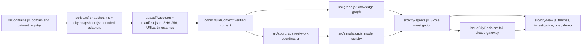

# CORE city intelligence architecture (Phase 2D)

CORE is meant to grow into an explorable, evidence-grounded digital counterpart of Earth. This document describes the part that runs today in San Francisco and how new domains plug in. It is all static and deterministic, with no paid service, and nothing acts on the physical world.

## Layers

1. **Domain registry** (`src/domains.js`). Seven domains, each with a status:

   | Domain | Status |
   | --- | --- |
   | Infrastructure | working |
   | Buildings and housing | working |
   | Nature and environment | partial |
   | Energy | partial |
   | Public space and land | partial |
   | Society and communities | candidate |
   | Events and decisions | partial |

   Each dataset spec declares: id, domain(s), provider, update frequency, kind (observed, administrative, self-reported, study), geometry, temporal field, dedupe key, schema and normalizer.

   To add a domain, append a `DOMAINS` entry and dataset specs; the UI lists it automatically. The domain stays disabled until its status is `working` or `partial` **and** its map layers exist.
2. **Adapters.** Bounded SoQL queries (corridor CNNs, bounding boxes, recency), schema validation, deduplication, PII removal, a frontage-distance post-filter, merged manifest entries, and change detection against the previous checksum. On failure, the previous snapshot is kept.
3. **Knowledge graph** (`src/graph.js`):
   - **Entities:** StreetSegment, Location, Permit (street use and building), Organization, Tree, Event (closure, removal notice), Observation (moratorium), InfrastructureAsset (sidewalk), Parcel, Building (energy), Park, Hypothesis.
   - **Relationships:** each carries `basis` ∈ {observed, derived, rule, hypothesis} and a required `why`:
     - *Observed:* CNN fields, permit holders, tree IDs on removal notices, parcels.
     - *Derived:* distances, explicit `distance_m`.
     - *Rule:* temporal overlaps, recency.
     - *Hypothesis:* `AFFECTS` is hypothesis-only, which the code enforces.
   - **Contradictions:** recorded with `CONTRADICTED_BY`.
   - **Size:** about 2,700 entities and 4,400 relations for the corridor, rebuilt deterministically in the browser in under 100 ms.
4. **Simulation interface** (`src/simulation.js`). Each model has a version, domain, kind, calibration flag, input digest, uncertainty text and note.

   | Model | Status |
   | --- | --- |
   | `coordination-schedule-v1` | Working |
   | `tree-proximity-exposure-v1` | Working (a proximity indicator, not a damage model) |
   | `evidence-completeness-v1` | Working |
   | `core-point-queue-v0` | Reference only (synthetic) |
   | `energy-model` | Explicitly unavailable |
   | `ecology-model` | Explicitly unavailable |
   | `traffic-model-real` | Explicitly unavailable |

   Future engines (SUMO, energy, water, land use) register here with the same result contract.
5. **Orchestration** (`src/city-agents.js`). A generator yields one event per executed operation, across eight logical roles:

   | Role | What it does |
   | --- | --- |
   | Discovery | Builds the graph and computes domain signals per segment |
   | Evidence | Checks checksums, records, dates and geometry |
   | Cross-domain reasoning | Produces a testable hypothesis with claims C1–C3, NEAR relations and contradictions |
   | Scenario generation | Builds R0 reference, R1 coordinated intervention, R2 defer-and-investigate |
   | Evaluation | Runs the models |
   | Adversarial review | Applies seven perturbations P1–P7 and lists missing evidence |
   | Synthesis | Writes the Decision Brief and the ranking with reasons |
   | Human decision gateway | Applies the fail-closed rules below |

   **Model providers:** `registerProvider` accepts future providers that propose; their output is never trusted without recomputation. None is registered.
6. **Gateway** (`issueCityDecision`). It checks, in order:
   1. contract (no unknown fields);
   2. parameters;
   3. snapshot checksums verified and identical;
   4. location;
   5. dates;
   6. independent recomputation of discovery, evidence, hypothesis, domains, evaluation, alternatives, adversarial review, ranking and recommendation;
   7. constraints;
   8. essential evidence for the recommended action;
   9. sensitivity rule.

   **Outcome:**
   - `ÉLIGIBLE À LA REVUE HUMAINE` — eligible for human review.
   - `PREUVES SUPPLÉMENTAIRES REQUISES` — more evidence required.
   - `REJETÉ` — rejected.
   - `authorizes` is always `false`.

   **Sensitivity rule:**
   - *Intervention (R1):* must survive every perturbation.
   - *Investigation (R2):* must survive a majority, with the sensitivity disclosed.
7. **UI.**
   - **Explore:** globe → San Francisco.
   - **Understand:** a Themes panel listing every domain with its status, with clustered building permits and a period filter.
   - **Discover and investigate:** an Investigation tab with live, paused and replayed runs, parameter sliders that recompute, and map synchronisation (block, works, trees, tree↔permit links, building permits, energy buildings).
   - **Decide:** the Decision Brief, gateway checks and JSON export.
   - **Guided demo:** nine user-paced steps that call the real functions.

## Reproducibility

The same snapshot and parameters give the same events and fingerprint (FNV-1a, non-cryptographic) in Node, Chrome and Firefox; this is audited. Snapshot authenticity rests on the SHA-256 manifest of public data.

## What this architecture does not claim

- No calibrated physical, energy, ecological or traffic model.
- No causal inference from proximity.
- No individual-level social data.
- No real-time feeds.
- No automated action.
